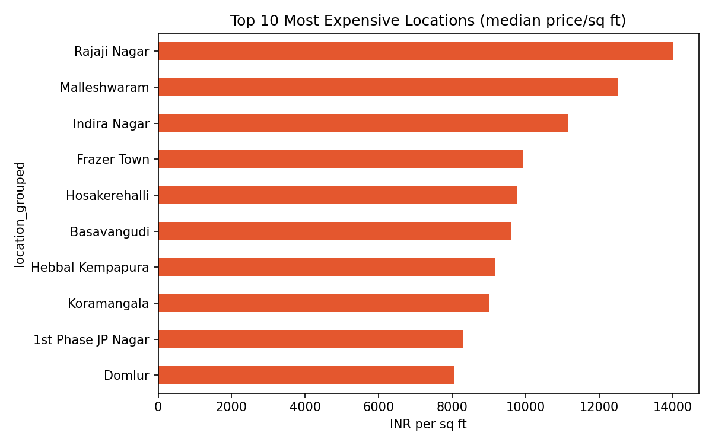
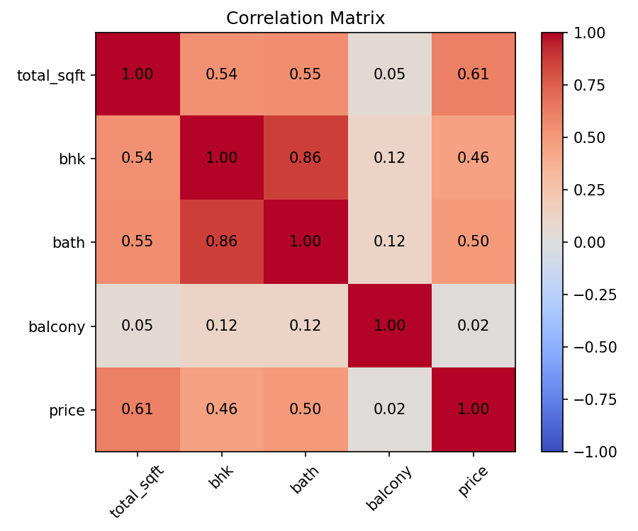

# Bengaluru House Prices: Data Cleaning and Exploratory Analysis

**Tools:** Python, pandas, matplotlib

## 1. Business problem
A buyer or real-estate agent in Bengaluru wants to know: **what drives house prices, and which areas offer the best value per square foot?**

## 2. Data
- Source: [Bengaluru House Price Data](https://www.kaggle.com/) (Kaggle), listings with area type, location, size (BHK), total sq ft, bathrooms, balconies and price (in lakhs INR).
- Raw dataset: (13320, 9)
- After cleaning: **10,034 listings**.
- Known issues in the raw data: missing values, sq ft stored as text (ranges like "1133 - 1384", unit-based values), inconsistent size labels ("2 BHK" vs "4 Bedroom"), duplicates and extreme outliers.

## 3. Approach
1. Dropped columns with too many missing values (`society`, `availability`).
2. Filled missing bathrooms with the median and missing balconies with 0; dropped rows with no size.
3. Extracted the number of bedrooms (BHK) from text labels.
4. Converted `total_sqft` to numbers (averaged ranges, removed unit-based values like Perch or Sq. Meter).
5. Created a `price_per_sqft` column (INR).
6. Removed duplicates and unrealistic listings (under 300 sq ft per bedroom, or far more bathrooms than bedrooms).
7. Removed price-per-sq-ft outliers within each location (outside 1 standard deviation of that location's mean).
8. Grouped rare locations (10 or fewer listings) into "Other".

## 4. Key findings
- **Size is the strongest driver of price** (correlation 0.61), followed by number of bathrooms (0.50). Balconies barely matter (0.02).
- **BHK and bathrooms move together** (correlation 0.86), so they carry nearly the same information about a property.
- **Most expensive area** (with at least 15 listings): **Rajaji Nagar**, at a median of about **₹13,998 per sq ft**.
- **Cheapest areas** (with at least 15 listings): Ananth Nagar, Attibele, Bommasandra Industrial Area, Chandapura and Kammasandra, mostly on the outskirts of the city.
- Price rises with area for every BHK type, but at the same size, listings with more bedrooms tend to cost more, and 4 BHK prices vary far more than 1 or 2 BHK, which suggests location and quality matter a lot for larger homes.


 
## 5. Recommendation
- Buyers on a budget get the lowest price per sq ft on the city's outskirts, but should weigh commute and infrastructure.
- Buyers paying for extra bathrooms should know that bathroom count mostly tracks bedroom count, so it adds little independent value.
- Compare listings using **price per sq ft within the same location**, not raw price, because size and area together explain most of the price.

## 6. Limitations and next steps
- Some extreme outliers remain after cleaning, so medians are more reliable than means here.
- Listing prices are asking prices, not final sale prices.
- Next step: build a simple regression model to predict price from size, BHK, bathrooms and location.

## 7. How to run
```
pip install pandas numpy matplotlib
python project1_cleaning_eda.py
```
Download `Bengaluru_House_Data.csv` from Kaggle and place it in the same folder first.
